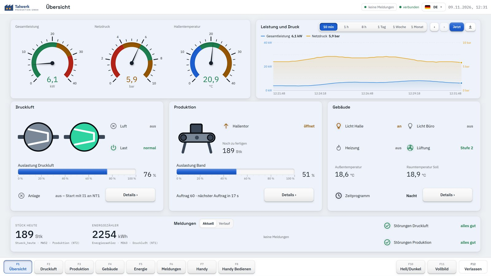
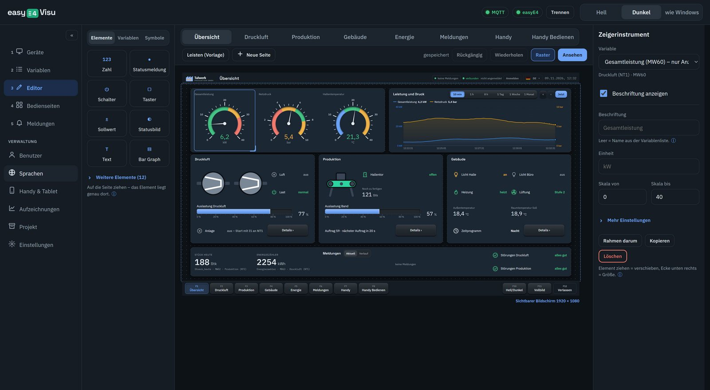
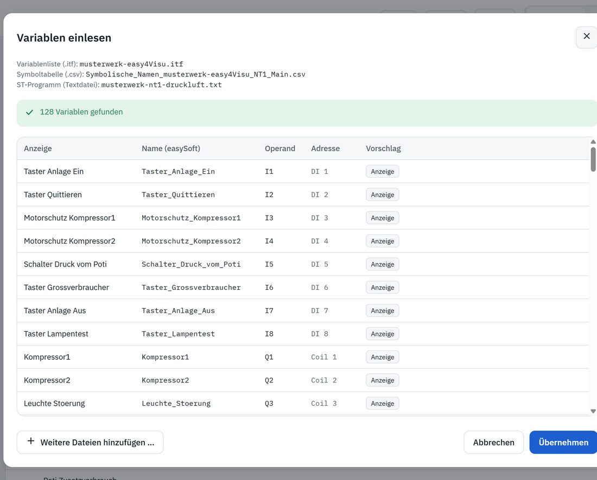
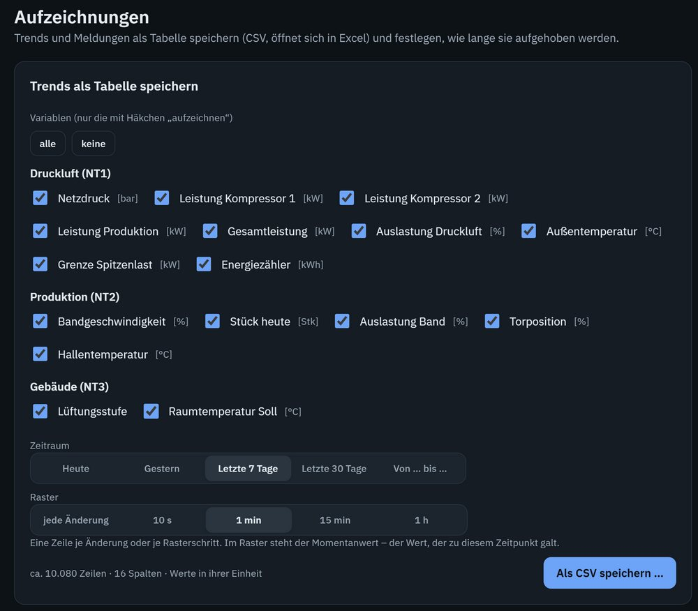
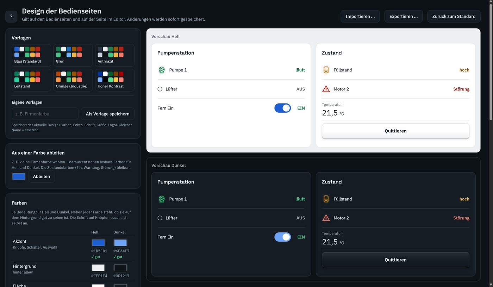

# easy4Visu

**Moderne Visualisierung für die easyE4** – die easyE4 auf einen Blick, am PC, Tablet und Handy.

easy4Visu ist ein eigenständiges Windows-Programm für die Steuerungsrelais **easyE4**. Variablen werden direkt
aus dem easySoft-Projekt übernommen, Bedienseiten entstehen per Drag & Drop im Editor. Kein Node-RED, keine
Datenbank, keine weitere Software nötig.



Webseite: [easy4visu.de](https://easy4visu.de) · Handbuch (PDF): [docs/handbuch/easy4Visu-Handbuch.pdf](docs/handbuch/easy4Visu-Handbuch.pdf)

## Was easy4Visu kann

- **Drei Verbindungen**, je Gerät wählbar: Modbus TCP, Webserver (JSON-API) und MQTT – mehrere easyE4 gleichzeitig
- **Variablen einlesen** aus easySoft: Variablenliste `.itf` (wie bei Galileo), Symboltabelle `.csv`,
  ST-Programm als Textdatei, bei FUP/KOP der Export der Operanden-Kommentare `.xls` – Register muss niemand kennen
- **Editor** mit Drag & Drop: Anzeigen, Taster, Schalter, Sollwerte, Balken, Zeiger, Trends, Lampen, Symbole, eigene Bilder
- **Design**: hell und dunkel, mehrere Vorlagen, eigene Farbthemen
- **Meldungen** (Störung, Warnung, Meldung) mit Quittieren und Verlauf
- **Trends** mit eingebauter Aufzeichnung – einfach einen Haken setzen
- **Benutzer und Rechte** mit Bedienprotokoll
- **Mehrsprachig** mit Texttabelle (Excel), Sprachwahl auf der Bedienseite
- **Handy und Tablet** im Browser, nach Anmeldung
- **Betrieb an der Anlage**: Start mit Windows, Vollbild, Neustart nach Absturz
- **Demo Talwerk**: Beispielprojekt mit drei simulierten easyE4 – ausprobieren ohne Gerät

| | |
|---|---|
|  |  |
|  |  |

## Installieren

1. Unter [Releases](../../releases) die Datei **easy4Visu-Setup.exe** herunterladen.
2. Doppelklicken und den Schritten folgen. Zeigt Windows „Der Computer wurde durch Windows geschützt“:
   **Weitere Informationen → Trotzdem ausführen** (das Setup ist nicht kostenpflichtig signiert).

**Voraussetzungen:** Windows 10 oder 11 (64 Bit). easyE4 mit Ethernet; MQTT ab Firmware 2.40.
Getestet mit easyE4 Firmware 1.4x und 2.46 sowie easySoft 8.46.

Alles Weitere steht im [Handbuch](docs/handbuch/easy4Visu-Handbuch.pdf).

## Für Entwickler

Benötigt [Node.js](https://nodejs.org) (Version 20 oder neuer).

```
npm install
npm start          # Programm starten
npm test           # automatische Tests (mit Simulatoren der easyE4)
npm run dist       # Setup bauen (dist/easy4Visu-Setup.exe)
```

| Ordner | Inhalt |
|---|---|
| `app/` | Programmfenster (Electron) und Oberfläche |
| `src/` | Programmkern: `import/` (Variablen einlesen), `protocols/` (Modbus TCP, Webserver, MQTT, Demo), `core/` (Geräte, Seiten, Meldungen, Aufzeichnung), `web/` (Browser-Zugang), `i18n/` (Sprachdateien) |
| `test/` | automatische Tests, `test/sim/` = Simulatoren der easyE4 |
| `tools/` | Prüfprogramme, z. B. für echte Geräte (`node tools/probe.js --help`, Anleitung [docs/GERAETETEST.md](docs/GERAETETEST.md)) |
| `demo/talwerk/` | Demo-Projekt „Talwerk“ |
| `beispiele/` | Beispieldateien aus easySoft (für die Tests) |
| `docs/` | Handbuch und Dateiformate ([.itf](docs/ITF-FORMAT.md), [Operanden in ST](docs/ST-OPERANDEN.md), [Variablen](docs/VARIABLEN.md), [Projekt](docs/PROJEKT-FORMAT.md)) |

Fehler und Wünsche bitte als [Issue](../../issues) melden – mit Firmware-Stand der easyE4, Verbindungsart und Windows-Version.

## Wichtiger Hinweis

easy4Visu ist eine Visualisierung, **keine Sicherheitsfunktion**. Not-Halt und Schutzfunktionen gehören in die
Steuerung und die Hardware.

## Lizenz und Marken

MIT – siehe [LICENSE](LICENSE). Lizenzen der mitgelieferten Bausteine: [LIZENZEN-DRITTER.txt](LIZENZEN-DRITTER.txt).

easy4Visu ist ein privates Open-Source-Projekt und **kein Produkt von Eaton**.
easyE4, easySoft und Galileo sind Marken der Eaton Corporation.

---

### English

**easy4Visu** is a free, open-source HMI/SCADA-style visualization for the **Eaton easyE4** control relay (Windows).
It connects via Modbus TCP, the built-in web server (JSON API) or MQTT, imports variables straight from easySoft
(.itf, symbol table, ST program, FBD/LD operand comments) and offers a drag & drop editor, alarms, trends,
users and roles, multiple languages and access from phones and tablets. The user interface is available in
German and English; the manual is in German. Download the installer from [Releases](../../releases).
Not an Eaton product; easyE4, easySoft and Galileo are trademarks of Eaton Corporation. License: MIT.
